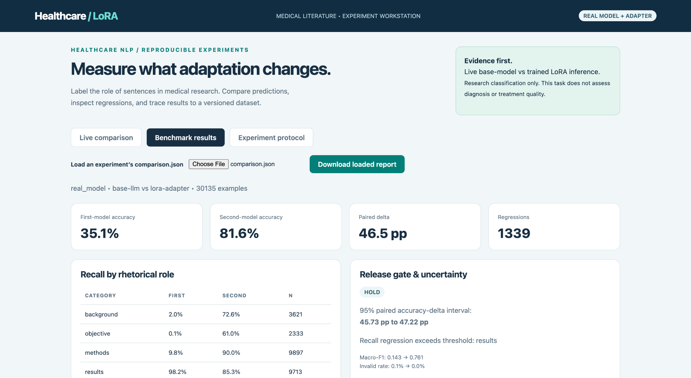
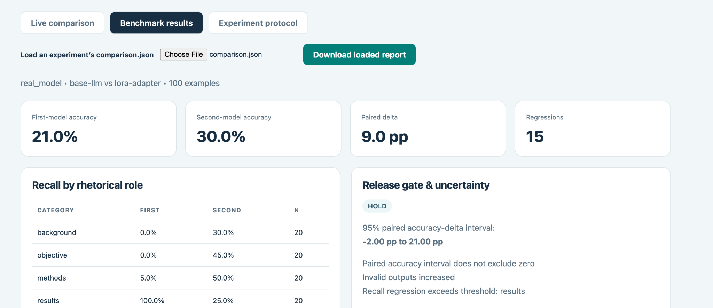
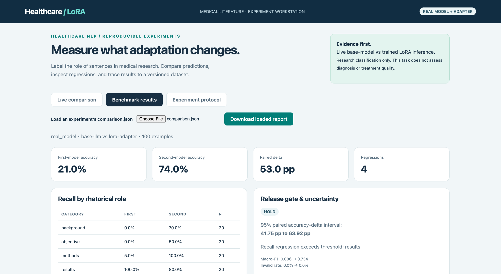
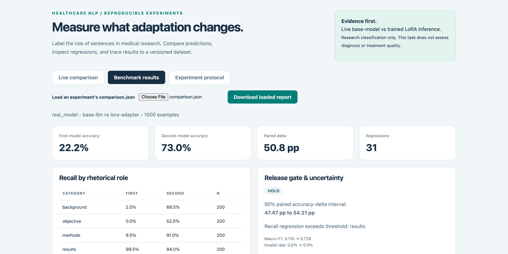
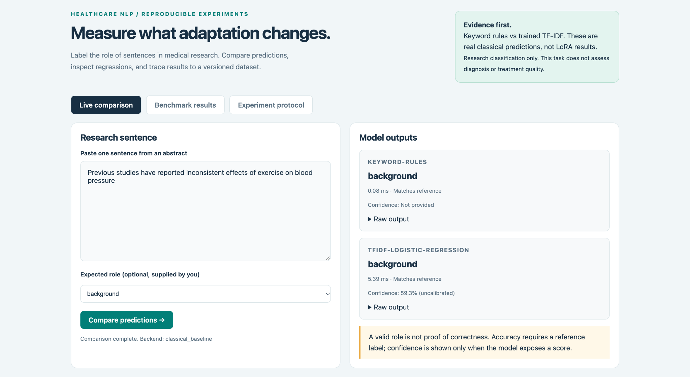
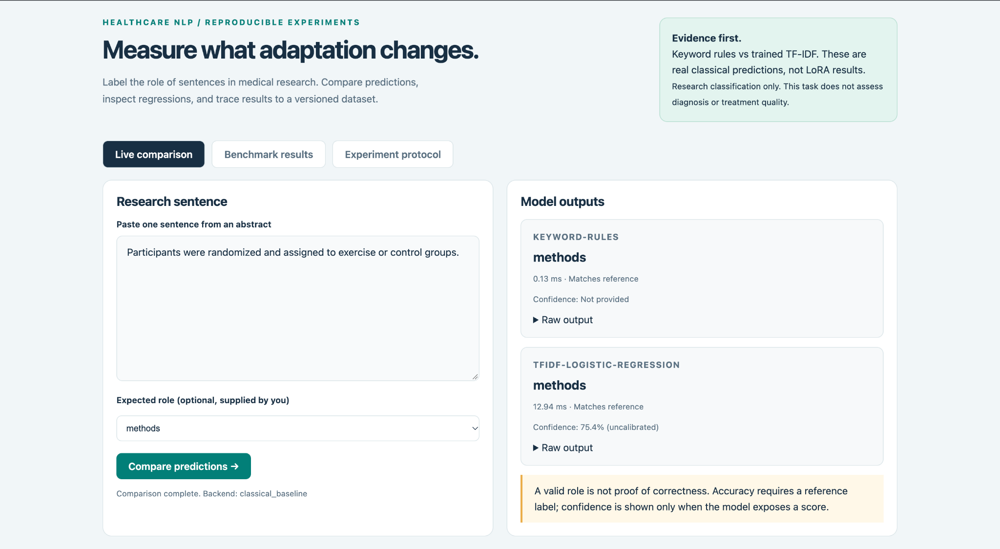
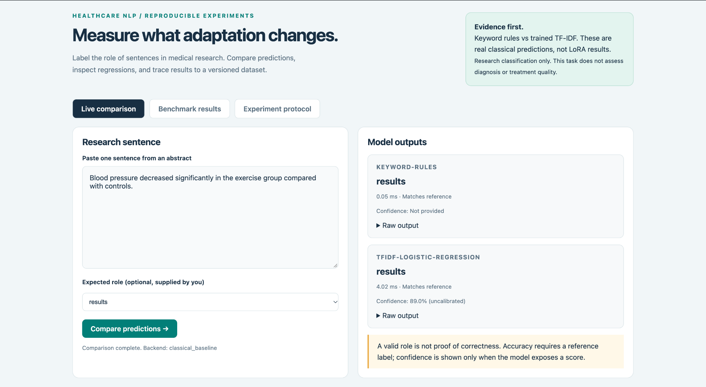
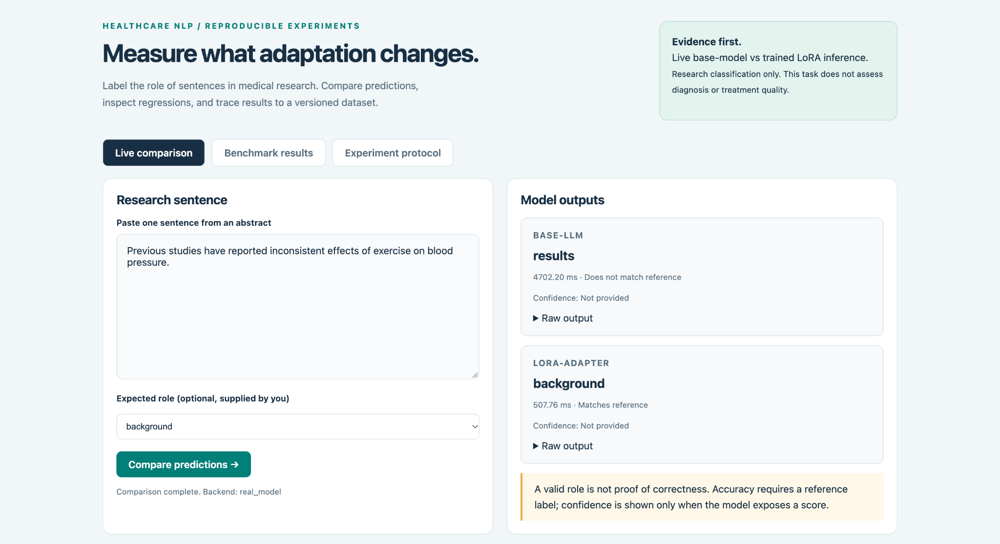
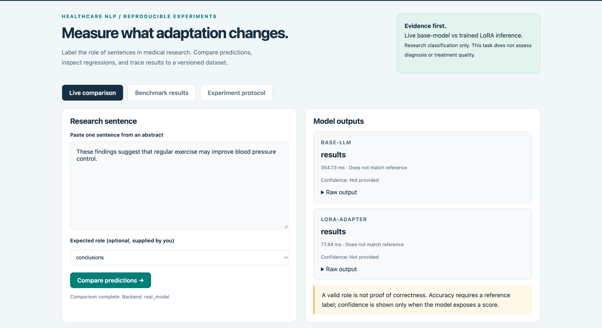

# Healthcare LoRA

**Fine-tuning a language model to classify sentences in biomedical research abstracts—with reproducible experiments and transparent evaluation.**

Healthcare LoRA identifies the rhetorical role of a sentence from a randomized controlled trial abstract: **Background, Objective, Methods, Results, or Conclusions**. It combines a public benchmark, classical baselines, parameter-efficient fine-tuning, and an interactive dashboard for inspecting both improvements and regressions.

The final LoRA model reached **81.6% accuracy** and **0.761 macro F1** on all **30,135 sentences** in the official PubMed 20k RCT test split. Compared with the same language model using the fixed task prompt without its adapter, accuracy improved by **46.5 percentage points**.

<!-- Screenshot slot 01: full official test benchmark -->


> **Status:** Research prototype. The conservative release gate remains **HOLD** because Results-class recall falls relative to the base model. Overall improvement does not erase a class-specific regression.

## What this project demonstrates

- An end-to-end workflow: download → audit → prepare → train → evaluate → inspect.
- LoRA adaptation of **Qwen2.5-0.5B-Instruct** using Hugging Face Transformers and PEFT.
- Keyword and TF-IDF/logistic-regression baselines alongside the language model.
- Paired evaluation on identical examples, including macro F1, per-class recall, invalid outputs, and regressions.
- Confidence intervals that resample entire abstracts rather than treating their sentences as independent.
- A dashboard for live base/adapter comparisons and loading saved experiment reports.
- Traceable model and dataset revisions, split hashes, adapter manifests, and automated checks.

## Final test results

All rows below use the official test split: **30,135 sentences from 2,500 abstracts**.

| Model | Accuracy | Macro F1 |
| :--- | ---: | ---: |
| Keyword rules | 36.52% | 0.3657 |
| TF-IDF + logistic regression | 77.66% | 0.7186 |
| Qwen2.5-0.5B-Instruct, fixed prompt | 35.1% | 0.143 |
| **Qwen2.5-0.5B-Instruct + LoRA** | **81.6%** | **0.761** |

The LoRA adapter's paired accuracy gain over the base language model is **+46.5 pp**, with a **95% confidence interval of +45.73 to +47.22 pp**. The adapter also introduces **1,339 regressions**: examples the base model classified correctly that the adapter classified incorrectly.

The TF-IDF model is a stronger reference than the weak fixed-prompt language-model baseline. LoRA exceeds its reported accuracy by approximately **3.9 pp**, but that cross-model difference is descriptive; no paired significance claim is made for it. Training budgets also differ: the classical model used 20,000 sampled training sentences, while the larger LoRA configuration used 1,000.

### Why the release gate says HOLD

The base model strongly favors the Results label. On the full test split, Results recall is **98.2%** for the base model and **85.3%** for the adapter: a **12.9 pp drop**, exceeding the gate's 5 pp tolerance.

Meanwhile, the adapter raises Background recall from **2.0% to 72.6%**, Objective recall from **0.1% to 61.0%**, and Methods recall from **9.8% to 90.0%**. These changes explain the substantial aggregate gain while exposing the tradeoff.

The gate requires an accuracy gain, a positive lower confidence bound, no increase in invalid outputs, acceptable per-class recall changes, and acceptable retention when measured. Its thresholds should be set before evaluation—not relaxed after observing the test result.

## Experiment progression

| Experiment | Split / examples | Base accuracy | LoRA accuracy | Gain | Base → LoRA macro F1 | 95% gain interval |
| :--- | :--- | ---: | ---: | ---: | :--- | :--- |
| Initial adapter | Validation / 100 | 21.0% | 30.0% | +9.0 pp | 0.086 → 0.279 | −2.00 to +21.00 pp |
| Larger training run | Validation / 100 | 21.0% | 74.0% | +53.0 pp | 0.086 → 0.734 | +41.75 to +63.92 pp |
| Larger training run | Validation / 1,000 | 22.2% | 73.0% | +50.8 pp | 0.110 → 0.728 | +47.47 to +54.21 pp |
| **Final evaluation** | **Test / 30,135** | **35.1%** | **81.6%** | **+46.5 pp** | **0.143 → 0.761** | **+45.73 to +47.22 pp** |

Validation samples are class-balanced; the full test split retains its natural class distribution. Accuracy across these different evaluation sets should not be interpreted as a directly comparable learning curve.

The initial adapter did not establish a reliable gain: its confidence interval includes zero, invalid outputs increased, and Results recall regressed. The larger run substantially improves aggregate metrics, but its class-specific regression still triggers HOLD.

Values are rounded from recorded reports and dashboard screenshots. Preserve the complete JSON reports alongside these screenshots for exact values and provenance.

<details>
<summary><strong>Validation screenshots: initial adapter and larger training run</strong></summary>

### Initial adapter — 100 validation sentences

<!-- Screenshot slots 04 and 05: historical initial-adapter evaluation -->



### Larger training run — 100 validation sentences

<!-- Screenshot slot 02 -->

### Larger training run — 1,000 validation sentences

<!-- Screenshot slot 03 -->

</details>

## Dataset and task

This project uses **PubMed 20k RCT**, a standard dataset of labeled sentences from biomedical randomized controlled trial abstracts.

| Official split | Abstracts | Sentences |
| :--- | ---: | ---: |
| Training | 15,000 | 180,040 |
| Validation | 2,500 | 30,212 |
| Test | 2,500 | 30,135 |

Each sentence receives one of five labels:

| Label | Meaning |
| :--- | :--- |
| Background | Context and motivation for the study |
| Objective | The study's question or intended aim |
| Methods | Study design, participants, procedures, or analysis |
| Results | Observed findings and outcomes |
| Conclusions | Interpretation and implications of the findings |

**Task scope:** independent sentence classification. The model does not receive surrounding sentences or their positions. Results should therefore not be compared directly with sequential abstract-classification systems that use that extra context.

### Reproducibility and overlap audit

The downloader pins upstream revision `17ed2cb0590decfca0266add0c76f254f67232b4` and records checksums. Official abstract-level partitions are retained.

- PMID overlap between splits: **0**.
- Full normalized abstract overlap between splits: **0**.
- Shared normalized sentences: **208** train/validation, **210** train/test, and **95** validation/test.

Shared boilerplate sentences remain in the official benchmark. Near-duplicate abstracts and possible base-model pretraining contamination are not ruled out.

Dataset: [PubMed RCT repository](https://github.com/Franck-Dernoncourt/pubmed-rct)  
Paper: [Dernoncourt & Lee, 2017 — PubMed 200k RCT](https://aclanthology.org/I17-2052/)

## Model and training

The workflow uses **Qwen/Qwen2.5-0.5B-Instruct**, pinned to revision `7ae557604adf67be50417f59c2c2f167def9a775`, with LoRA applied to the attention `q_proj` and `v_proj` modules.

| Setting | Initial smoke configuration | Larger training configuration |
| :--- | :--- | :--- |
| Training sentences | 100 | 1,000 |
| Validation sentences for training | 50 | 500 |
| LoRA rank / alpha | 8 / 16 | 16 / 32 |
| Learning rate | 0.0001 | 0.0002 |
| Epoch budget | 1 | 3 |
| LoRA dropout | 0.05 | 0.05 |
| Maximum sequence length | 512 | 512 |
| Per-device training batch size | 1 | 1 |
| Gradient accumulation | 4 | 4 |
| Seed | 42 | 42 |

These are the configurations used in the project walkthrough; commit the actual final configuration and adapter manifest with the experiment evidence. Training uses completion-only loss, validation-based checkpoint selection, and early stopping. The epoch budget does not imply that every run necessarily completed that many epochs.

The initial bundled adapter is a smoke-test artifact. **Use `models/training-run/adapter` for the larger trained model reported here.** Adapter weights are excluded from Git by default.

## Run locally

### 1. Create a supported Python environment

Use **Python 3.12**. The project supports Python 3.11–3.13.

```bash
conda create -n healthcare-lora python=3.12 -y
conda activate healthcare-lora

python -m pip install --upgrade pip
python -m pip install -e '.[dev]'
```

### 2. Download and prepare the benchmark

Run these commands from the project root:

```bash
python -m healthcare_lora.cli fetch
python -m healthcare_lora.cli prepare
```

### 3. Run the classical baseline

```bash
python -m healthcare_lora.cli baseline

export HEALTHCARE_LORA_BACKEND=baseline
python -m healthcare_lora.cli serve
```

Open **http://127.0.0.1:8000** for the dashboard and **http://127.0.0.1:8000/docs** for the API documentation.

### 4. Train and evaluate LoRA

Install the training dependencies and use the larger run's saved configuration:

```bash
python -m pip install -e '.[train]'
python -m healthcare_lora.cli train --config configs/training.json
```

Training refuses to overwrite a nonempty output directory. For another run, use a new output directory in its configuration.

Evaluate the adapter on the complete official test split:

```bash
python -m healthcare_lora.cli evaluate \
  --backend hf \
  --config configs/training.json \
  --adapter models/training-run/adapter \
  --dataset data/processed/test.jsonl \
  --retention \
  --output results/experiments/final-test
```

Omitting `--limit` evaluates the complete split. Use validation data for experimentation and preserve the test set for final evaluation. Changing the model after inspecting test results requires disclosing that additional test-set use.

### 5. Open the trained-model dashboard

```bash
export HEALTHCARE_LORA_BACKEND=hf
export HEALTHCARE_LORA_CONFIG=configs/training.json
export HEALTHCARE_LORA_ADAPTER=models/training-run/adapter

python -m healthcare_lora.cli serve
```

**Live comparison:** enter a biomedical sentence and inspect the base and adapted predictions. An optional expected label is used for scoring, never as model input.

**Benchmark results:** choose a run's `comparison.json`. The default bundled report is a classical-baseline comparison, so explicitly load the final test report to view the final LoRA results.

**Experiment protocol:** inspect the evaluation rules and release criteria.

## Evaluation design

The evaluator aligns predictions by example identity and checks the reference labels and sentence hashes before comparison. Invalid label outputs count as errors.

It reports accuracy, macro F1, per-class recall, invalid-output rates, and paired improvements/regressions. Confidence intervals use **2,000 abstract-cluster bootstrap resamples**, with seed 42, to account for correlation between sentences in the same abstract.

The retention suite is a small, authored set of general tasks with strict answer-format checks. It is a diagnostic—not evidence that broad general capabilities have been preserved.

## Dashboard examples

The following examples are functional demonstrations, not a five-example benchmark. The adapter screenshots in this gallery come from the **initial smoke adapter**, including its mistakes; they do not represent the final trained adapter.

<details>
<summary><strong>Classical baseline: all five rhetorical roles</strong></summary>









</details>

<details>
<summary><strong>Initial LoRA live comparisons: successes and failures</strong></summary>




png)

</details>

## Repository layout

```text
healthcare-lora/
├── healthcare_lora/       # Dataset, training, evaluation, API, and dashboard
├── configs/               # Versioned experiment configurations
├── data/                  # Downloaded and prepared data; generated data ignored
├── models/                # Local models and adapters; weights ignored
├── results/               # Saved experiment reports and prediction outputs
├── docs/
│   └── images/            # Screenshots referenced in this README
├── scripts/               # Supporting workflows
├── tests/                 # Automated checks
├── .github/workflows/     # Continuous integration
├── pyproject.toml
└── README.md
```

## Preserve the experiment evidence

Commit small evaluation reports, prediction files, configurations, and the adapter manifest. Screenshots complement these machine-readable artifacts.

For the final run, keep:

```text
results/experiments/final-test/
├── comparison.json
├── experiment.md
├── base.jsonl
└── adapted.jsonl

configs/training.json
docs/images/
```

Also copy `models/training-run/adapter/manifest.json` to a tracked results directory, for example `results/final_test/adapter_manifest.json`. The manifest captures model/configuration provenance and adapter checksums without committing the model weights.

If using the experiment archive script, retain the timestamped report bundles under `results/experiment_results/`.

## Checks

```bash
python -m pytest
python -m ruff check .
```

The project includes automated checks for its data and evaluation workflows, serving behavior, and adapter handling. Optional tiny-model integration checks exercise training, export, and reload without treating a toy model as performance evidence.

## Limitations and next experiments

- The fixed-prompt base model is weak and label-biased. Test stronger prompts and few-shot baselines on validation data.
- Resolve the Results-recall tradeoff without selecting changes against the final test set.
- Add repeated training seeds and matched training-budget comparisons.
- Evaluate sequential context as a separate task with clearly documented inputs.
- Expand retention evaluation beyond the small strict-format diagnostic suite.
- Capture a fresh live-comparison screenshot using the final adapter in optional slot 16.

This project supports research-document organization. It is not a diagnostic, treatment, or clinical decision system.

## Attribution and licensing

Project code is distributed under the repository's **MIT license**. Qwen model licensing is separate; consult the upstream model license.

PubMed abstract text does **not** have a blanket redistribution license through this project. Follow the upstream dataset guidance and [NLM copyright policy](https://www.nlm.nih.gov/web_policies.html#copyright). Download source text through the provided workflow rather than committing the raw dataset.

**Author:** Mayuresh Suhas Mohnalkar

